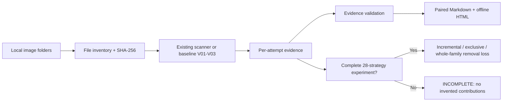

# QR Audit — Offline QR Code Scanning & Strategy Audit Skill

[English](README.md) | [简体中文](README.zh-CN.md)

**QR Audit (`qr-audit`)** is an open-source AI Coding Skill and local Python toolkit for **offline QR code decoding**, **QR scanner source-code auditing**, **image preprocessing strategy analysis**, and **reproducible scan reports**. It helps investigate failed scans and prioritize fewer manual reviews **without claiming to reproduce the WeChat scanner**.

> **Current implementation boundary:** The bundled reference scanner runs **three baseline variants (V01–V03)** using locally installed OpenCV; ZXing-C++ can be added if available. It **registers 28 historical strategies**, but **V04–V28 are not implemented or run by the bundled scanner**. For a genuine 28-strategy experiment, first connect an existing scanner using the [adapter contract](references/adapter-contract.md). The word “28” describes the **strategy registry**, not a verified 28-algorithm implementation.

## Why QR Audit?

When QR codes are blurred, low-contrast, inverted, cropped, or missing a quiet zone, one image transform or decoder may not be enough. A naive “try everything” loop can inflate runtime and obscure which preprocessing method actually helped. QR Audit separates **the original image**, **strategy**, **decoder**, **attempt**, **QR detection**, **successful decoding**, and **business validation** so that you can measure recall rather than guessing.

It supports offline workflows where the WeChat app cannot be used, paired exports like `WAVES_QR` / `WAVES_QR_RAW`, and side-by-side results with an explicit checkmark when **either** version decodes.

## What is implemented today?

| Capability | Current status |
| --- | --- |
| Scan PNG/JPEG and other supported images locally | **Available**, with installed OpenCV + NumPy |
| Reference preprocessing V01 original, V02 grayscale, V03 contrast | **Available**; reference implementation, not a copy of your scanner |
| Optional secondary ZXing-C++ decoder | **Supported when locally installed**; verify the exact runtime configuration |
| Registry for 28 historical preprocessing/decoder configurations | **Available as definitions only**; V04–V28 require an adapter |
| Read-only source hint search | **Available**; hints are not confirmed implementation evidence |
| Recursive mixed paired/standalone inventory with group-scoped pair IDs | **Available** |
| Ordinary scanning with early stop | **Available**; missing later attempts must be recorded |
| Generic strategy/decoder executor adapter | **Available**; adapter modules can register audited V01–V28 implementations without changing their preprocessing algorithms |
| Evidence schema v2 with run/input/hash/retry/source validation | **Available**; structural and provenance status are separate |
| Before/after input consistency gate | **Available**; content changes, additions and deletions invalidate contribution conclusions |
| Separate file-level and pair-level contribution/removal-loss metrics | **Available** |
| Complete contribution experiment | **Available only when every declared strategy/decoder is connected and all provenance checks pass** |
| Individual strategy uniqueness and whole-family removal loss | **Available** only when the experiment evidence is complete |
| Markdown + same-name, offline responsive HTML reports | **Available** |
| Native WeChat App compatibility, business success, automatic strategy deletion | **Not verified / not provided** |

**Interpret results carefully:** `DECODED` means a local decoder returned a QR payload. It does *not* establish that WeChat can scan it, the destination URL responds, or the business transaction works. `DETECTED_ONLY` is not a successful decode.

## Quick start on Windows / Codex

Install this Skill by cloning into your actual Codex Skills directory:

```powershell
git clone https://github.com/yeqiana/qr-audit.git "$HOME\.agents\skills\qr-audit"
Test-Path "$HOME\.agents\skills\qr-audit\SKILL.md"
```

For Claude Code, clone into `"$HOME\.claude\skills\qr-audit"` instead. Start a new agent session and confirm the actual `name: qr-audit` entry is loaded. Installation alone does not guarantee automatic invocation.

Invoke it explicitly:

```text
$qr-audit Scan a local QR image folder offline, produce per-directory and paired reports, and do not open QR payload links.
$qr-audit Audit the current scanner's 28 strategy definitions, actual code paths, early-stop behavior, decoding options, and independent contribution evidence.
$qr-audit Run a complete strategy-contribution analysis from this run-manifest.json, attempts.jsonl and inventory.json; verify source/registry/input provenance and report file-level and pair-level family-removal loss.
```

Run the bundled **reference baseline** (Python 3; install `opencv-python` and `numpy` separately and explicitly in your offline environment):

```powershell
$skill = "$HOME\.agents\skills\qr-audit"
$input = 'D:\workSpace\本地电脑\03-图片扫描检测\检测文件'
python "$skill\scripts\run.py" scan --input-root "$input" --report-root "$input\report" --decoder opencv

# With a locally importable adapter module, contribution mode disables early stopping:
python "$skill\scripts\run.py" scan --experiment-mode contribution --input-root "$input" --report-root "$input\report" --adapter-module my_qr_adapter --decoder opencv
```

The run will be marked `PASS_BASELINE_ONLY` — not a complete 28-strategy audit or contribution experiment. Contribution analysis requires schema 2.0 evidence plus both `--inventory` and `--inventory-after`, the frozen registry, stable input snapshots, and verified local source fingerprints. The unified `scan --experiment-mode contribution` command writes file-level and pair-level CSVs under that run's evidence directory when every gate passes. The Skill **never installs packages, downloads models, logs into WeChat, or follows QR payload URLs without user authorization**. Read the [Chinese quick start](README.zh-CN.md) or the [FAQ](docs/faq.md) for prerequisites and limitation details.

## Scan → audit → contribution analysis → evidence



Each input group produces at least **three Markdown files plus three same-stem HTML files**: left-side results, right-side results, and combined pair results. Missing sides and unmatched files remain visible; a payload mismatch is flagged for manual review. Outputs are stored under a **new run-specific report directory**. Source images and previous evidence remain unchanged.

## What makes a strategy contribution trustworthy?

- **Ordered new success:** the strategy decodes images that previous strategies did not decode in the chosen order.
- **Repeated success:** the strategy decodes images that previous strategies already decoded.
- **Exclusive contribution:** only this strategy succeeds on an image, across the complete experiment.
- **Whole-family removal loss:** the number of successful images lost after removing *all* strategies in a family such as `pure_mode`.

> **Important:** A zero *individual exclusive contribution* for each pure-mode variant does **not** imply zero loss from removing the **entire pure-mode branch**. Incomplete experiment matrices, missing combinations, early stopping, and error states must not be represented as zero loss.

See the [file-vs-pair metrics](docs/metrics.md), [schema 2.0 evidence contract](references/evidence-contract.md), and [generic executor adapter](references/adapter-contract.md).

## Existing native scanner CLI bridge

If the 28 actual preprocessing variants live in a separate native program, the optional [native CLI bridge](docs/real-scanner-onboarding.md) can invoke that program **without reimplementing image transformations**. Configure `QR_AUDIT_BRIDGE_CONFIG` with an audited mapping of registry ID to native strategy ID, and use `--adapter-module external_cli_adapter --decoder native`. Each subprocess response must attest the run, source image SHA-256, strategy, decoder and payloads; mismatches block valid contribution evidence. The bridge uses literal argv and no shell, but it cannot sandbox an untrusted native executable.

**Connection status:** This repository has an adapter interface and synthetic tests, not a verified implementation mapping for the user's actual 28 strategies. The native scanner and 709-pair image corpus must be available on the same Runner before real recall and manual-review metrics can be measured.

## Documentation

- [README 中文版 / Chinese README](README.zh-CN.md)
- [FAQ — offline QR decoding, WeChat limitation, 28 variants, installation](docs/faq.md)
- [Architecture and two scanning modes](docs/architecture.md)
- [Contribution metrics with a concrete counterexample](docs/metrics.md)
- [How QR Audit differs from ZXing-C++, OpenCV and ZBar](docs/comparison.md)
- [Realistic Windows workflow and report directory examples](examples/windows-paired-folders/README.md)
- [Adapter contract for your existing 28-strategy scanner](references/adapter-contract.md)
- [Safe offline HTML reporting and optional gen-ui integration](references/genui-html.md)
- [GEO / AI-search evidence and repeatable discovery evaluation](docs/geo-methodology.md)
- [Recommended GitHub repository About text, topics and manual checklist](docs/github-metadata.md)
- [Full Skill instructions](SKILL.md)

## Optional integrations, not hard dependencies

- [gen-ui](https://github.com/yeqiana/gen-ui): optional visual presentation guidance for accessible Markdown/HTML; **not a QR decoder or HTML runtime**.
- [PlanShip](https://github.com/yeqiana/plan-ship): reference for pairing an authoritative Markdown with an offline HTML companion; QR Audit does not require it.
- [code-pact](https://github.com/yeqiana/code-pact): optional engineering workflow conventions; not required to scan.

The Skill does not require WebCodex Runner, a custom ACP runtime, Git, or an MCP server for its **instruction workflow**. Actual local decoding requires the project's own installed decoder libraries, or a compatible external adapter. The included CLI uses Python.

## Test and validation

```powershell
python -m unittest discover -s tests -v
python scripts/validate_skill_package.py
python scripts/run.py --help
```

These checks test the package and fixtures. They **do not certify** WeChat scan compatibility, real-world recall on your image set, or that all 28 strategies have been executed. See [test status and boundaries](RELEASE-NOTES.md).

## Security, contributions and license

- No QR payload URL is opened; treat decoded content as potentially sensitive untrusted data.
- No automatic deletion of existing strategies, images, sources or results.
- [Security policy](SECURITY.md) · [Contributing](CONTRIBUTING.md) · [MIT License](LICENSE)

**Canonical repository:** https://github.com/yeqiana/qr-audit

**Search intent:** offline QR code scanner; QR decoding failure analysis; QR image preprocessing benchmark; ZXing-C++ and OpenCV QR code strategy audit; QR decoding contribution analysis; Markdown and offline HTML scan reports; AI Coding Skill for Codex and Claude Code.

## Fresh runs and bounded image concurrency (v1.3.0)

Each run uses a new Python process, a unique run ID, and an explicit selected source checkout. The manifest fingerprints the active Skill, scanner implementation, adapters, registry, and relevant configuration. It checks that these files did not change during the run. Offline execution cannot establish that the selected checkout is the newest remote commit; that is an operator-controlled choice.

```powershell
python scripts/run.py scan --input-root "D:\\images" --report-root "D:\\reports" --workers 1
python scripts/run.py scan --input-root "D:\\images" --report-root "D:\\reports" --workers 4
```

The default is **one worker**. The bounded thread pool processes independent images, but emits evidence in a stable input order via one writer. Extra workers do not necessarily run faster: first verify native decoder/adapter thread safety and compare 1, 2, 4 and 8 workers on the same image hashes and software versions. A changed source file blocks a trustworthy run (`BLOCKED_SOURCE_CHANGED`). Scan mode may stop early; complete contribution experiments must not.

See [optimization and acceptance protocol](docs/scanning-optimization.md). These changes do not claim improved QR decoding coverage or full V01–V28 native implementation.

## Opt-in QR recognition boost experiments (v1.4.0)

The original V01–V28 registry and default scan behavior are unchanged. B01–B05 are an **independent, explicitly selected OpenCV reference experiment**, not an attestation that any native V strategy has been implemented or replaced. B01 keeps the original pixels; B02 adds quiet-zone padding after nearest-neighbor upscaling; B03 applies Otsu binarization; B04 CLAHE plus Otsu; B05 adaptive Gaussian binarization. Padding can help when only the quiet zone is missing, but never recovers physically cropped QR data modules.

```powershell
python scripts/run.py scan --input-root "D:\\samples" --report-root "D:\\reports" --decoder opencv --workers 1 --registry-path assets/strategy-registry.boost.json --adapter-module recognition_boost_adapter
```

Use a frozen SHA-256 input set, stable decoder/options, original raw scans, and independent labeled ground truth before claiming increased **correct** file/pair coverage. The included synthetic QR tests check complete decoded payloads, but **no real historical image dataset has been rescanned**. For full contribution analysis use `--experiment-mode contribution` and the same opt-in registry. See [recognition boost protocol](docs/recognition-boost.md).

## v1.4.1: Fail-closed recognition non-regression gate

Evidence schema PASS and registered strategy IDs do **not** prove old QR decoding coverage was preserved. The default reference scanner still implements V01–V03 only; using it alone must not be presented as an upgrade over an existing native scanner. B01–B05 experimental enhancement modes are independent and do not reproduce the legacy pure-mode branches.

Before an upgrade run, provide `--require-strategy V04 --require-strategy V10` (and other genuinely required native IDs) to reject missing executors before scan start. Supply `--baseline-evidence` on `scripts/run.py scan` to compare the complete old decoded file, eligible pair and payload-identity sets after execution, or run the stand-alone read-only gate:

```powershell
python scripts/regression_gate.py --baseline-evidence "D:\\old\\evidence" --candidate-evidence "D:\\new\\evidence"
```

Changed input hashes, lost old decoded files or pairs, conflicting old payload identities, or unverifiable evidence **block upgrade acceptance**, even if the new aggregate success count is larger. The tests use synthetic examples; the actual 2,560-image historical corpus must still be checked on its own machine. The v1.4.1 export installer includes the B-series adapter, experiment registry and regression validator. See [non-regression protocol](docs/recognition-regression-gate.md).

## v1.5.0: Native evidence, core zero-regression gating, illumination experiments

The non-regression gate now runs **inside `scan_images.run_scan`** (including custom low-level runners), not just within the higher CLI. The historical schema-2 pair aliases `left_ids/right_ids` are read without modifying old evidence. For strict upgrade jobs, set `QR_AUDIT_BASELINE_EVIDENCE` to the existing evidence folder and `QR_AUDIT_REQUIRE_BASELINE=1` in the runner environment. Any historical loss or unverifiable baseline blocks acceptance; without that configuration the default remains a baseline scan, **not an upgrade certificate**.

The read-only `native_coverage_audit.py` tool checks evidence for native execution of V04/V10/V11/V12; it cannot restore source code that lives on another machine. Additional **opt-in** experiments B06 (exposure-aware Gamma), B07 (local Sauvola), B08 (background flattening plus Otsu) do not change V01–V28. The optional `wechat_decoder_adapter.py` supports local model files only, with 4 Caffe assets on OpenCV 4 and 2 ONNX assets on OpenCV 5. Never treat it as identical to the WeChat mobile app.

See `docs/native-coverage-acceptance.md`, `docs/brightness-experiment.md`, and `docs/wechat-decoder-experiment.md`. Real-sample improvements and the historical 2,560-image gate remain **not verified** until tested on the owner's scanner machine.

## v1.5.1: opt-in real fallback execution after the existing scanner

Unlike the earlier standalone boost registry, the new `--boost-fallback` option **appends** B01–B08 after all current strategy IDs, only evaluating them on images where earlier strategies have not decoded a payload. The optional `--wechat-fallback` additionally appends W01 as a last-resort WeChatQRCode original-image decoder, using pre-existing local models only; it requires `--boost-fallback`.

Original strategy definitions and ordering are left untouched. The effective combined registry is frozen to `evidence/strategy-registry.effective.json`, while incremental offline decode coverage is recorded in `evidence/fallback-summary.json`. Native source-file adapters are never fed experimental pixel transforms. **The fallback is not a replacement for missing V04/V10 implementations**, nor a claim that 2,560 real images have been rescanned. Run the historical zero-regression gate with real old evidence and verify payload truth independently. See [failure fallback guide](docs/failure-fallback-usage.md).

## v1.5.2: bounded preprocessing, ROI rectification, selected WeChat boosted variants

B02–B08 now select an output scale within the 8M-pixel cap (4x/3x/2x/1x, or area downsampling when even native size exceeds the budget). B09 is an independent opt-in OpenCV QR quadrilateral rectification experiment, with a post-warp quiet zone; it is **not** an equivalent native Vxx implementation and presently processes the largest candidate only. When `--wechat-fallback` is enabled and model weights are available locally, the offline WeChat decoder receives selected B02/B04/B06/B08/B09 variants before the final raw W01 attempt. The default no-fallback path is unchanged.

The fallback summary now additionally separates rescues by decoder and by strategy/decoder. These are **observed decoding coverage**, not validated payload correctness. Real-image improvement against the historical 431-file/409-pair baseline still requires locally executed zero-regression evidence. See `docs/recognition-recovery-v152.md`.
