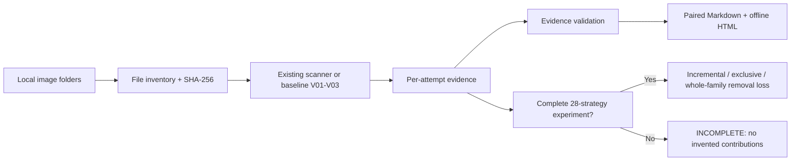

# QR Audit — Offline QR Code Scanning & Strategy Audit Skill

[English](README.md) | [简体中文](README.zh-CN.md)

**QR Audit (`qr-audit`)** is an open-source AI Coding Skill and local Python toolkit for **offline QR code decoding**, **QR scanner source-code auditing**, **image preprocessing strategy analysis**, and **reproducible scan reports**. It helps investigate failed scans and prioritize fewer manual reviews **without claiming to reproduce the WeChat scanner**.

> **Current implementation boundary:** The bundled reference scanner runs **three baseline variants (V01–V03)** using locally installed OpenCV; ZXing-C++ can be added if available. It **registers 28 historical strategies**, but **V04–V28 are not implemented or run by the bundled scanner**. For a genuine 28-strategy experiment, first connect an existing scanner using the [adapter contract](references/adapter-contract.md). The word “28” describes the **strategy registry**, not a verified 28-algorithm implementation.

## Why QR Audit?

When QR codes are blurred, low-contrast, inverted, cropped, or missing a quiet zone, one image transform or decoder may not be enough. A naive “try everything” loop can inflate runtime and obscure which preprocessing method actually helped. QR Audit separates **the original image**, **strategy**, **decoder**, **attempt**, **QR detection**, **successful decoding**, and **business validation** so that you can measure recall rather than guessing.

It supports offline workflows where the WeChat app cannot be used, paired exports like `WAVES_QR` / `WAVES_QR_RAW`, and side-by-side results with an explicit checkmark when **either** version decodes.

## What is implemented today?

| Capability | Current status |
| --- | --- |
| Scan PNG/JPEG and other supported images locally | **Available**, with installed OpenCV + NumPy |
| Reference preprocessing V01 original, V02 grayscale, V03 contrast | **Available**; reference implementation, not a copy of your scanner |
| Optional secondary ZXing-C++ decoder | **Supported when locally installed**; verify the exact runtime configuration |
| Registry for 28 historical preprocessing/decoder configurations | **Available as definitions only**; V04–V28 require an adapter |
| Read-only source hint search | **Available**; hints are not confirmed implementation evidence |
| Paired/grouped image inventory and unmatched-file reporting | **Available** |
| Ordinary scanning with early stop | **Available**; missing later attempts must be recorded |
| Complete contribution experiment | **Analysis available** for complete externally generated attempt evidence; not executable for 28 strategies out of the box |
| Individual strategy uniqueness and whole-family removal loss | **Available** only when the experiment evidence is complete |
| Markdown + same-name, offline responsive HTML reports | **Available** |
| Native WeChat App compatibility, business success, automatic strategy deletion | **Not verified / not provided** |

**Interpret results carefully:** `DECODED` means a local decoder returned a QR payload. It does *not* establish that WeChat can scan it, the destination URL responds, or the business transaction works. `DETECTED_ONLY` is not a successful decode.

## Quick start on Windows / Codex

Install this Skill by cloning into your actual Codex Skills directory:

```powershell
git clone https://github.com/yeqiana/qr-audit.git "$HOME\.agents\skills\qr-audit"
Test-Path "$HOME\.agents\skills\qr-audit\SKILL.md"
```

For Claude Code, clone into `"$HOME\.claude\skills\qr-audit"` instead. Start a new agent session and confirm the actual `name: qr-audit` entry is loaded. Installation alone does not guarantee automatic invocation.

Invoke it explicitly:

```text
$qr-audit Scan a local QR image folder offline, produce per-directory and paired reports, and do not open QR payload links.
$qr-audit Audit the current scanner's 28 strategy definitions, actual code paths, early-stop behavior, decoding options, and independent contribution evidence.
$qr-audit Run a complete strategy-contribution analysis from this run-manifest.json and attempts.jsonl; report whole-family removal loss and reject incomplete matrices.
```

Run the bundled **reference baseline** (Python 3; install `opencv-python` and `numpy` separately and explicitly in your offline environment):

```powershell
$skill = "$HOME\.agents\skills\qr-audit"
$input = 'D:\workSpace\本地电脑\03-图片扫描检测\检测文件'
python "$skill\scripts\run.py" scan --input-root "$input" --report-root "$input\report" --decoder opencv
```

The run will be marked `PASS_BASELINE_ONLY` — not a complete 28-strategy audit or contribution experiment. The Skill **never installs packages, downloads models, logs into WeChat, or follows QR payload URLs without user authorization**. Read the [Chinese quick start](README.zh-CN.md) or the [FAQ](docs/faq.md) for prerequisites and limitation details.

## Scan → audit → contribution analysis → evidence



Each input group produces at least **three Markdown files plus three same-stem HTML files**: left-side results, right-side results, and combined pair results. Missing sides and unmatched files remain visible; a payload mismatch is flagged for manual review. Outputs are stored under a **new run-specific report directory**. Source images and previous evidence remain unchanged.

## What makes a strategy contribution trustworthy?

- **Ordered new success:** the strategy decodes images that previous strategies did not decode in the chosen order.
- **Repeated success:** the strategy decodes images that previous strategies already decoded.
- **Exclusive contribution:** only this strategy succeeds on an image, across the complete experiment.
- **Whole-family removal loss:** the number of successful images lost after removing *all* strategies in a family such as `pure_mode`.

> **Important:** A zero *individual exclusive contribution* for each pure-mode variant does **not** imply zero loss from removing the **entire pure-mode branch**. Incomplete experiment matrices, missing combinations, early stopping, and error states must not be represented as zero loss.

See the [metrics explanation](docs/metrics.md) and [evidence contract](references/evidence-contract.md).

## Documentation

- [README 中文版 / Chinese README](README.zh-CN.md)
- [FAQ — offline QR decoding, WeChat limitation, 28 variants, installation](docs/faq.md)
- [Architecture and two scanning modes](docs/architecture.md)
- [Contribution metrics with a concrete counterexample](docs/metrics.md)
- [How QR Audit differs from ZXing-C++, OpenCV and ZBar](docs/comparison.md)
- [Realistic Windows workflow and report directory examples](examples/windows-paired-folders/README.md)
- [Adapter contract for your existing 28-strategy scanner](references/adapter-contract.md)
- [Safe offline HTML reporting and optional gen-ui integration](references/genui-html.md)
- [GEO / AI-search evidence and repeatable discovery evaluation](docs/geo-methodology.md)
- [Recommended GitHub repository About text, topics and manual checklist](docs/github-metadata.md)
- [Full Skill instructions](SKILL.md)

## Optional integrations, not hard dependencies

- [gen-ui](https://github.com/yeqiana/gen-ui): optional visual presentation guidance for accessible Markdown/HTML; **not a QR decoder or HTML runtime**.
- [PlanShip](https://github.com/yeqiana/plan-ship): reference for pairing an authoritative Markdown with an offline HTML companion; QR Audit does not require it.
- [code-pact](https://github.com/yeqiana/code-pact): optional engineering workflow conventions; not required to scan.

The Skill does not require WebCodex Runner, a custom ACP runtime, Git, or an MCP server for its **instruction workflow**. Actual local decoding requires the project's own installed decoder libraries, or a compatible external adapter. The included CLI uses Python.

## Test and validation

```powershell
python -m unittest discover -s tests -v
python scripts/validate_skill_package.py
python scripts/run.py --help
```

These checks test the package and fixtures. They **do not certify** WeChat scan compatibility, real-world recall on your image set, or that all 28 strategies have been executed. See [test status and boundaries](RELEASE-NOTES.md).

## Security, contributions and license

- No QR payload URL is opened; treat decoded content as potentially sensitive untrusted data.
- No automatic deletion of existing strategies, images, sources or results.
- [Security policy](SECURITY.md) · [Contributing](CONTRIBUTING.md) · [MIT License](LICENSE)

**Canonical repository:** https://github.com/yeqiana/qr-audit

**Search intent:** offline QR code scanner; QR decoding failure analysis; QR image preprocessing benchmark; ZXing-C++ and OpenCV QR code strategy audit; QR decoding contribution analysis; Markdown and offline HTML scan reports; AI Coding Skill for Codex and Claude Code.