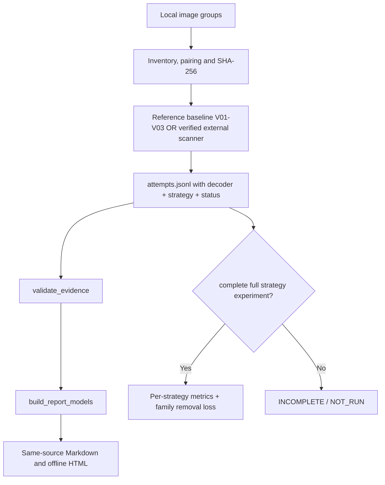

# Architecture — evidence-first QR scanning Skill

QR Audit has two separable layers:

1. **Agent Skill contract (`SKILL.md`)**: prompts a compatible coding agent to inspect the real scanner, respect local privacy, run the correct mode, interpret evidence, and avoid fake completion.
2. **Python reference helpers (`scripts/`)**: inventory and hash local images; run baseline variants with already installed libraries; validate attempts; compute metrics; build same-source Markdown/HTML reports.

The 28-entry strategy registry is data (`assets/strategy-registry.initial.json`), not executable code for 28 variants.

### Stable identities

`image_id` identifies a file; `strategy_id` identifies the preprocessing/configuration recipe; `decoder_id` identifies the software decoder; `attempt_id` distinguishes one `image × strategy × decoder` invocation. `WAVES_QR` and `WAVES_QR_RAW` are directory names, **not** engines. A complete contribution experiment records every eligible combination, including explicit skips.

### Result vocabulary

`DECODED`: a local decoder returned nonempty QR payload. `DETECTED_ONLY`: a QR region was detected but no valid payload returned. `NO_DECODE`: attempt ran but decoded nothing. `NOT_RUN`: missing implementation or unexecuted strategy. `ERROR`: execution failed. `PAYLOAD_CONFLICT`: two successful decodes disagree. `NOT_TESTED`: WeChat app result is unknown. These states may not be merged into a generic “success”.

### Scanner adapters

A verified external adapter can supply V04–V28 attempts. Its schema and checks are defined by [adapter-contract.md](../references/adapter-contract.md) and [evidence-contract.md](../references/evidence-contract.md). An adapter must not mark unexecuted variants as successful or silently insert fake attempts.

### Offline documents

The report model is an intermediate JSON representation; Markdown and same-stem HTML are emitted together. The static HTML renderer is intentionally conservative: text-escaped payloads, no script execution and no network calls.
